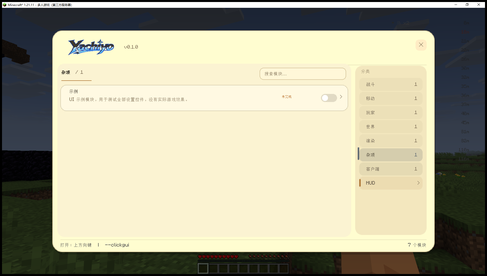
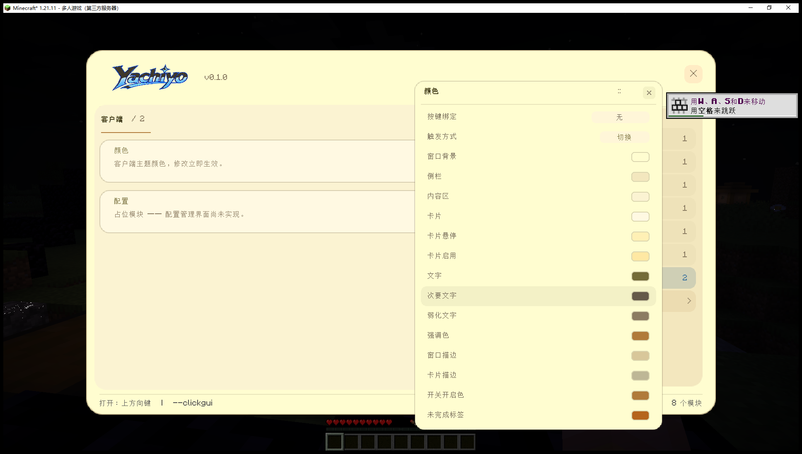
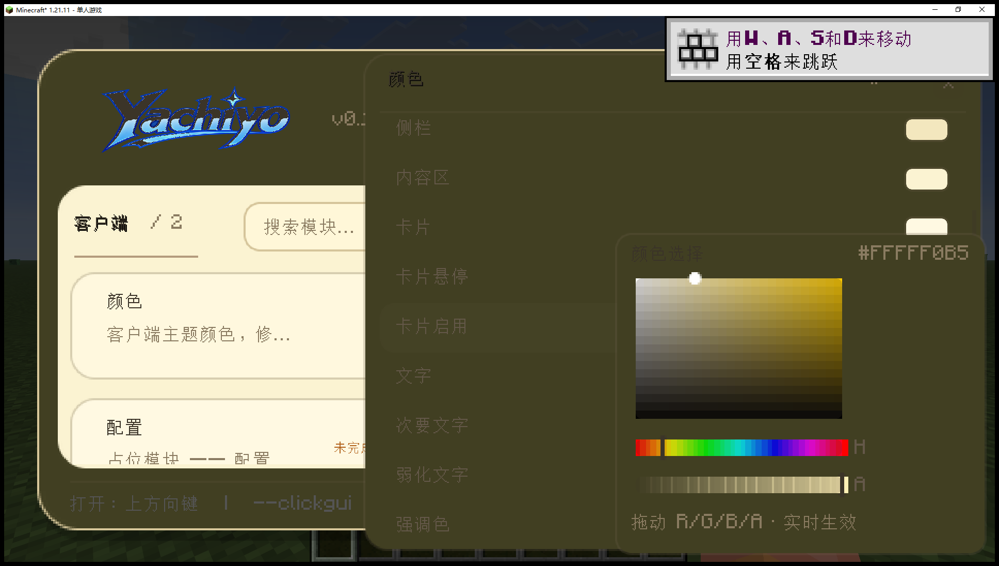
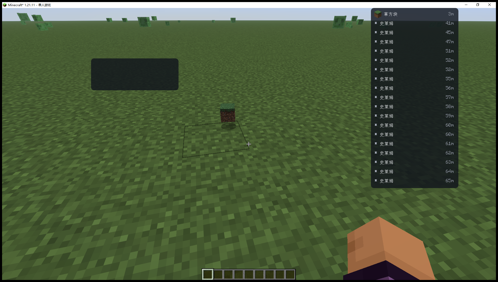

# YachiyoC 开发指南

在任何情况下不能动git，不得执行git相关命令，除非用户同意
> 版本：`0.1.0`（UI 壳子 / foundation build）
> 目标：Minecraft **1.21.11** + Fabric，面向无政府服务器生存自动化。
> 当前只实现 UI、模块/设置模型、指令与配置骨架；**没有任何战斗/移动/自动化功能**。



---

## 1. 当前完成度

| 能力 | 状态 | 说明 |
|---|---|---|
| Fabric 工程 | ✅ | MC 1.21.11、Java 21、Gradle 9.2、Loom 1.15.5 |
| ClickGUI 壳子 | ✅ | 右侧分类栏、横向模块卡、搜索、滚动、动态高度、圆角遮罩 |
| 模块/设置模型 | ✅ | Bool / Double / Enum / Color / Keybind / Button，JSON 持久化 |
| 交互 | ✅ | 模块开关、模块按键、切换/按住触发、按钮动作、关闭按钮 |
| 模块分类 | ✅ | Combat / Movement / Player / World / Render / Misc / Tools / Client |
| 模块实现 | ⏳ | 9 个模块（含占位），Colors 为纯设置模块，Example 有 UI 演示设置 |
| 中文 | ✅ | 默认 `zh_cn`，`en_us` 同步维护，可在配置/指令切换 |
| 指令 | ✅ | 前缀 `--`，`--clickgui`、`--help`、`--prefix`、`--openkey`、`--language`、`--modules`、`--config`、`--debug`；支持 Tab 补全 |
| 打开按键 | ✅ | 默认 **↑**，可用 `--openkey` 修改 |
| HUD | ✅ | 右侧分类栏最后的 HUD 按钮、右键添加、物品显示/掉落物实体、右键设置、拖动 |
| 通用选择器 | ✅ | 左待选/右已选/搜索；物品、方块、实体共用；关注物品红色置顶 |
| 旋转 / 反作弊 | 🚧 | 旋转四种时序已接入 `aura`（含低版本静默）；服务端状态只有移动镜像，反作弊对抗未做 |

---

## 2. 环境与构建

### 2.1 版本矩阵

| 组件 | 版本 |
|---|---|
| Minecraft | `1.21.11` |
| Yarn mappings | `1.21.11+build.6` |
| Fabric Loader | `0.18.2` |
| Fabric API | `0.141.6+1.21.11` |
| Loom | `1.15.5` |
| Gradle | `9.2.0`（wrapper） |
| Java | 21（`C:\Program Files\Java\jdk-21`） |

### 2.2 命令

```powershell
$env:JAVA_HOME = 'C:\Program Files\Java\jdk-21'
$env:Path = "$env:JAVA_HOME\bin;$env:Path"

# 编译 + 打包
.\gradlew.bat --offline build

# 开发客户端
.\gradlew.bat --offline runClient

# 产物
build/libs/yachiyoc-0.1.0.jar
```

说明：

- 本机 Gradle/Loom/Minecraft 依赖已在缓存中，`--offline` 可构建；首次在别的机器构建可去掉 `--offline`。
- `run/` 是开发客户端的用户数据目录，包含 `saves/`、`options.txt`、`config/`、`mods/`；**任何清理都不能递归删除 `run/`**，只清 `run-client*.log`、测试截图等临时文件。
- 如果 `runClient` 报 `client.options is null`，说明语言逻辑被提前到了 mod init；当前实现已改为 `CLIENT_STARTED` 后执行。
- 开发客户端默认窗口很小（854×480）；验证布局时建议在 `run/options.txt` 里设置：
  ```text
  overrideWidth:1280
  overrideHeight:720
  ```

### 2.3 调试开关

**日志**（按功能开，默认全关；写日志文件，不进聊天栏）：

```text
--debug                 列出当前开着的调试功能（全关时提示“全关”）
--debug aura true       打开 aura 的调试输出（true/false，也认 on/off）
--debug aura false      关掉
--debug aura            省略值 = 取反
--debug all true        全部打开
--debug all false       全部关闭（只写 all 不带值时：有开着的就全关，全关着就全开）
```

开关保存在 `config/yachiyoc.json` 的 `debugFeatures` 里，重启保持；`--config reload` 后重新生效。

所有排查日志统一走 `dev.yachiyoc.platform.Debug`，**第一个参数是功能名**：

```java
Debug.log("aura", "wait — progress=%s", p);                       // 一条
Debug.logThrottled("aura", 2000L, "wait — progress=%s", p);       // 每 tick 触发的地方用它限流
```

功能名第一次被调用时会自动登记，`--debug ` 后面按 Tab 就能补全出来。
**不要**在这些地方直接调 `LOGGER.info` —— 那样关不掉。
真正需要用户看到的错误（配置读写失败、坏包防踢）仍然走 `Logger.error/warn`。

**GUI**：

```powershell
$env:YACHIYOC_DEBUG_GUI = '1'
.\gradlew.bat --offline runClient
```

进入世界（或标题界面）后自动打开 ClickGUI，便于截图/布局调试。**发布构建不要设置该环境变量。**

---

## 3. 目录结构

```text
src/main/java/dev/yachiyoc/
├── YachiyoC.java                 # 入口、生命周期、语言、保存
├── command/
│   ├── ClientCommand.java
│   ├── CommandContext.java
│   ├── CommandManager.java
│   ├── CommandCompleter.java
│   └── SimpleCommand.java
├── config/
│   ├── ConfigData.java           # JSON DTO（无 MC 类型）
│   └── ConfigManager.java        # 读取/原子写入/损坏备份
├── module/
│   ├── Module.java               # 模块基类、bind/trigger、enabled 生命周期
│   ├── ModuleCategory.java
│   ├── ModuleRegistry.java       # 只负责注册、状态/设置存取
│   ├── TriggerMode.java
│   ├── StubModule.java           # 占位模块
│   ├── setting/                  # 通用设置控件
│   └── impl/                     # 所有具体模块
│       ├── combat/
│       │   └── Aura.java         # 模块入口：选目标、请求旋转、调用攻击
│       ├── client/
│       │   ├── Colors.java       # 客户端颜色设置
│       │   └── Config.java       # 客户端聊天/默认旋转设置
│       └── misc/
│           ├── Example.java      # UI 演示模块
│           └── ViaFix.java       # Via 修复（长矛模型/蓄力 + 坏包防踢，模块内分开关）
├── combat/                       # 战斗领域服务
│   ├── TargetSelector.java       # 目标筛选/排序/范围
│   └── AttackScheduler.java      # 冷却、攻击、挥手
├── item/
│   └── SpearFix.java             # 长矛识别：剑→矛映射、Via 原始 id 读取、kinetic_weapon 取值
├── rotation/                     # 旋转系统
│   ├── RotationManager.java      # 旋转时序、静默转头包、攻击后恢复、lastYawClient 回同步
│   ├── RotationMode.java         # NONE/DELAY_MOVEMENT/MOVEMENT_POST(与延迟移动同实现)/SILENT_MOVEMENT/LEGACY_SILENT
│   └── RotationChoice.java       # FOLLOW + 模块覆盖
├── net/                          # 出站包观测
│   ├── ServerMovementState.java  # 服务端位置/朝向/onGround 镜像（低版本静默的依据）
│   ├── PacketOrderManager.java   # 出站包序统计
│   └── PostManager.java          # 交易边界动作队列
├── hud/
│   ├── HudManager.java
│   ├── HudElement.java
│   ├── HudEditorScreen.java
│   └── element/
│       ├── ItemDisplayHud.java
│       ├── DropDisplayHud.java
│       └── LogoHud.java
├── mixin/
├── platform/
└── ui/                           # ClickGUI，只放 GUI
    ├── ClickGuiScreen.java
    ├── RegistrySelectionScreen.java
    ├── Theme.java
    ├── anim/
    ├── render/
    └── widget/
```

> 事件总线、ServerState、PacketOrder、世界渲染等属于后续路线；当前不提前铺空类，等真正接入时再建。

资源：


```text
src/main/resources/
├── fabric.mod.json
└── assets/yachiyoc/
    ├── lang/{en_us,zh_cn}.json
    └── textures/
        ├── logo/logo.png          # 运行时 logo
        ├── logo/logo_mask.png     # 反色遮罩
        ├── logo/logo_glow.png     # HUD 发光 shader 用
        └── ui/rounded.png         # 64×64 抗锯齿圆角遮罩
```

---

## 4. 启动链路

```text
ClientModInitializer.onInitializeClient
  ├─ ConfigManager.load()                 # config/yachiyoc.json
  ├─ ModuleRegistry.bootstrap()           # 显式注册 9 个模块
  ├─ ModuleRegistry.load(config)          # 恢复 enabled / settings
  ├─ CommandManager.bootstrap()
  ├─ Keybinds.init() + apply(config key)
  ├─ ClientLifecycleEvents.CLIENT_STARTED → 应用语言 + reloadResources
  ├─ ClientTickEvents.END_CLIENT_TICK     → ↑ 键 / debug GUI / 模块 bind 轮询
  ├─ ClientSendMessageEvents.ALLOW_CHAT   → 前缀拦截
  └─ shutdown hook                        → saveAll
```

为什么要延迟语言：

- `onInitializeClient` 阶段 `MinecraftClient.options` 仍为 `null`，直接写会 NPE。
- `CLIENT_STARTED` 时 options 与资源管理器已就绪；若语言与配置不同，设置 `options.language`、`options.write()` 并 `reloadResources()`。
- 默认配置是 `zh_cn`，首次启动会把界面切成简体中文；想跟随 Minecraft 设置改成 `auto`。

---

## 5. UI 架构

### 5.1 分层

```text
ClickGuiScreen       窗口：背景、logo、右侧分类栏、搜索、卡片区、footer
  ├─ CategoryTab      右侧分类按钮（选中/悬停动画、模块计数）
  └─ ModuleCard       横向模块卡（名称/描述、WIP、开关）
       └─ 右键 → ModuleSettingsWindow（可拖动、可滚动）
            └─ SettingRow  设置行（bool/slider/enum/color/keybind/button）
```

渲染与输入全部经过：

- `Render2D`：矩形、**9-slice 圆角遮罩**、描边、裁剪、颜色混合。
- `Text2D`：测量、绘制、右对齐、居中、缩放、截断。
- `Theme`：颜色/圆角/行高/边距唯一来源。
- `Anim` + `Easing`：基于 `System.nanoTime()` 的动画，帧率无关。

### 5.2 布局

- 窗口居中，最大 `760×440`，按屏幕自动收缩；外圈 `WINDOW_RADIUS=20`。
- 顶栏高 `70`：左侧 logo 图片，右侧版本号 + 关闭按钮。
- 右侧分类栏宽 `142`，分类按钮竖向排列；选中项由一条滑动的强调色竖条标记。
- 窗口高度不足时分类栏内部滚动（滚轮在分类栏上），不会把按钮画到 footer 外面。
- 中间内容区：顶部分类名/计数 + 搜索框，下面是**横向模块卡**列表。
- 模块卡宽度占满内容区，固定高度 `52`；不再内联展开设置。
- 左键点击卡片切换模块；右键打开可拖动、可滚动的设置悬浮窗，所有设置都在窗口内。
- 设置窗口单列显示，每行 24px，超出高度用滚轮滚动。
- 内容超出卡片区高度时，滚轮滚动模块卡列表；窗口本身不滚动。
- 卡片区使用 `enableScissor`，滚动不会越界到 footer。
- 所有圆角都走 `UiTextures.rounded()` 的 64×64 抗锯齿遮罩做 9-slice，不再用逐行矩形堆角。

### 5.2.1 米色主题

当前 ClickGUI 使用 `#FFFDD0` 米色预设：

| 用途 | 颜色 |
|---|---|
| 窗口 | `#FFFDD0` |
| 侧栏 | `#F3E7BE` |
| 内容区 | `#FBF3D2` |
| 卡片 | `#FFF9E2` |
| 文字 | `#3B3428` |
| 次要文字 | `#65594A` |
| 强调 | `#B07A3A` |
| 描边 | `#D8C79A` / 深棕半透明 |

所有颜色集中在 `Theme.java`，组件不写死。后续客户端设置里的主题切换只需要替换一组 `Theme` 令牌。

### 5.2.2 模块设置悬浮窗

- 右键任意模块卡，在鼠标附近创建 `ModuleSettingsWindow`；
- 客户端颜色这种纯设置模块没有胶囊开关，左键/右键卡片都直接打开设置窗；
- 标题栏可拖动，关闭按钮在右上角；
- 所有设置单列排列，窗口高度超过屏幕时内部滚动；
- 不再使用卡片内联展开/下拉；
- 左键点击模块卡仍然只切换模块开关；
- 窗口内的按键绑定、String、Sound、Color、RegistryList 等控件与原来共用 `SettingRow`；
- 每行最右侧都有独立的 `↺` 重置按钮，只重置当前设置；
- 窗口最下方有红色“重置当前模块所有参数”按钮，点击后弹出确认框，确认才会重置整个模块。



### 5.2.3 客户端颜色设置

`客户端 → 颜色` 模块：

- 窗口背景、侧栏、内容区、卡片、悬停、文字、强调色、描边、开关色等都可以单独设置；
- 右键颜色色块，在色块下方展开 `ColorPickerPopup`；
- 调色盘包含 SV 方块、Hue 条、Alpha 条，拖动实时生效；
- 不切换屏幕，不遮挡整个 UI；
- 修改直接写入 `Theme`，所有 UI 立即更新；
- 每个颜色设置右侧有独立重置，恢复该颜色的默认值；
- 掉落物 HUD 默认显示玩家；玩家 ID 默认红色并置顶，可在 HUD 设置里关闭置顶。
- 配置保存在模块设置中，重启后恢复。



### 5.3 输入

| 输入 | 行为 |
|---|---|
| `↑`（默认） | 打开/关闭 ClickGUI（屏幕内也响应） |
| `ESC` | 关闭；若正在监听按键则取消监听 |
| 左键分类 | 切换分类（滑轨 + 内容位移动画） |
| 左键模块卡 | 切换模块 enabled |
| 右键模块卡 | 打开可拖动设置悬浮窗 |
| 左键纯设置模块 | 直接打开设置悬浮窗（无开关） |
| 拖动悬浮窗标题 | 移动设置窗口 |
| 右键颜色色块 | 展开内联 SV/Hue/Alpha 调色盘 |
| 点击设置行最右 `↺` | 只重置当前设置项 |
| `↑` / `↓` | 在指令补全候选上下选择 |
| 点击窗口底部红色重置 | 弹出确认框，确认后重置整个模块 |
| 左键“按键绑定” | 进入监听，下一次按键写入，ESC 清空 |
| 左键“触发方式” | 切换 `切换 / 按住` |
| 左键“执行”按钮 | 运行按钮动作（Example 里是重置设置） |
| 右上角 X | 关闭 |
| 滚轮 | 滚动模块卡列表 |
| 搜索框 | 输入过滤模块名/id；`ESC`/`Enter` 失焦 |

### 5.4 设置控件

| 类型 | 交互 | 显示 |
|---|---|---|
| `BoolSetting` | 点击切换 | 动画 knob + 轨道 |
| `DoubleSetting` | 点击/拖拽 | 右侧数值 + 轨道 |
| `EnumSetting` | 点击循环 | 右侧胶囊（读 `setting...<id>.value.<name>`，缺失回退枚举名） |
| `ColorSetting` | 点击循环调色板 | 右侧色块 |
| `BindSetting` | 点击监听，按键写入 | 右侧按键胶囊；监听时显示“按下按键…” |
| `ButtonSetting` | 点击执行 | 右侧“执行”按钮 |


新增设置类型时：

1. 继承 `Setting<T>`，实现 `displayValue/toJson/fromJson`。
2. 在 `SettingRow.render` 与 `mouseClicked/mouseDragged` 增加分支。
3. 在 `zh_cn.json` / `en_us.json` 增加 `setting.yachiyoc.<module>.<id>`。
4. 在 `ModuleRegistry.save/load` 不需要改动（按 `Setting` 多态处理）。

### 5.5 Logo 与贴图

- 运行时 logo：`assets/yachiyoc/textures/logo/logo.png`（720×221 透明 PNG）。
- 反色遮罩：`assets/yachiyoc/textures/logo/logo_mask.png`（RGB 预乘 alpha，透明区域 RGB=0，避免反色混合把整个矩形都染色）。
- HUD 发光纹理：`assets/yachiyoc/textures/logo/logo_glow.png`（白色 alpha 版本）。
- 显示：`Render2D.invertTexture(...)` 使用自定义 `pipeline/logo_invert`（`position_tex_color` + `INVERT` blend）；预乘白色遮罩与当前 GUI 背景逐像素反色，所以背景变深/变浅时 logo 自动形成反色轮廓。
- 如果 `logo_mask.png` 缺失，`UiTextures.logoMask()` 返回 null，自动回退到普通 `logo.png`。
- 冰蓝发光 shader 在 `assets/yachiyoc/shaders/core/yachiyo_hud.fsh`，对应 `pipeline/logo_glow`；多余的旧参考目录已删除。
- 圆角遮罩：`assets/yachiyoc/textures/ui/rounded.png`（64×64，半径 18，8× 超采样）。
- 改 logo 后重新生成透明纹理和遮罩即可；尺寸变化时同步修改 `Render2D.invertTexture` 的纹理宽高。

### 5.6 HUD 系统

入口：

- 右侧分类栏的 **最后一项** 是独立的 **HUD** 按钮（不是模块分类）；
- 首次加载会默认添加 `logo` HUD，位置 `12,12`，可用 HUD 编辑器拖动；
- 点击后 ClickGUI 关闭，进入透明 `HudEditorScreen`；
- 右键标题条：向下展开 HUD 配置，列出所有已有 HUD，可设置/删除或恢复默认；
- 右键空白：打开“添加 HUD 元素”菜单；
- 右键“物品显示”：添加并直接打开设置；
- 右键“掉落物 / 实体”：添加并直接打开设置；
- 右键已有 HUD：打开设置面板；
- “关注物品”右侧的 **选择 (N)** 按钮打开通用选择器；
- 左键拖动 HUD：移动，位置自动保存；
- HUD 编辑器顶部的标题条可以拖动，位置在本次编辑器会话内保留；
- 配置面板使用可复用的 `ExpandAnimation` 向下曲线展开，不另开小窗口；
- “恢复默认 HUD”会清空玩家添加的 HUD，并重新创建默认 Logo（位置 12,12、默认参数），需要再次点击确认。
- 设置面板的**标题栏可以拖动**，每个 HUD 的面板位置会保留到本次编辑器关闭；
- 设置面板右上角：**删除** / 关闭；
- 背景默认关闭；
- 掉落物“范围”的滑块最大值等于当前**实际已加载区块半径 × 16**，默认就是最大值；拉到最右会覆盖整个加载范围（16 区块加载时就是 256）；
- ESC：关闭设置/菜单，再按一次退出编辑器。



已有元素：

| HUD | 内容 | 设置 |
|---|---|---|
| `logo` | 冰蓝发光 Logo，默认开启、位置 `12,12` | 启用、动画速度、发光强度、描边宽度；位置拖动 |
| `item_display` | 9×3 主背包物品格，带堆叠数量 | 背景开关、缩放、背景颜色 |
| `drop_display` | 范围内掉落物/实体列表，按距离排序；同类动物/怪物合并为 `xN`，物品保持独立；玩家名字红色，关注物品红色置顶 | 范围、掉落物/实体/玩家开关、玩家 ID 置顶、行数、背景、缩放、关注物品选择器、聊天/声音提示、提示音效 |

新增 HUD：

1. 继承 `HudElement`，实现 `layout()` 与 `render(DrawContext)`；
2. 在 `HudManager.bootstrap()` 里 `register(new HudType("xxx", "hud.yachiyoc.xxx.description", XxxHud::new))`；
3. 在语言文件加 `hud.yachiyoc.xxx` / `.description` 和对应 `setting...`；
4. 不需要改编辑器——添加菜单、右键设置、拖动、持久化会自动生效。

### 5.7 音效下拉

- 音效文件放在 `assets/yachiyoc/textures/sounds/*.ogg`；
- `SoundRegistry` 扫描该目录，`SoundSetting` 直接把所有文件名列成下拉；
- 构建时 `processResources` 会把 ogg 复制到 `assets/yachiyoc/sounds/`，并生成 `sounds.json`；
- 以后其它模块需要选音效，直接 `add(new SoundSetting(owner, id, "默认文件名.ogg"))`，UI 复用同一个下拉。

注意：新增音效文件后需要重新 `build`，让资源复制和 `sounds.json` 更新；运行时不会热扫描 jar。

渲染入口：

```java
HudElementRegistry.addLast(Identifier.of("yachiyoc", "hud"),
        (context, tickCounter) -> HudManager.render(context));
```

- HUD 在游戏内常驻渲染；
- 编辑器只额外画边框、添加菜单和设置面板；
- HUD 坐标使用 GUI 缩放坐标，`Click` 坐标也是同一套。

### 5.8 通用注册表选择器

左侧待选、右侧已选，顶部搜索，点击条目或 `+` / `-` 切换：

```text
┌──────────────────────────────────────────────┐
│ 选择物品                            [X]      │
│ 左侧待选 · 右侧已选 · 点击条目切换           │
│ [搜索...]                                     │
│  待选 (1503)             已选 (2)             │
│  TNT                    +  钻石镐           - │
│  下界之星               +  附魔金苹果       - │
└──────────────────────────────────────────────┘
```

- `RegistrySelectionScreen` 是唯一选择界面，后续实体/方块/物品选择都复用它；
- `RegistryKind.ITEM / BLOCK / ENTITY` 决定列出哪个注册表：
  - `ITEM`：所有物品，包括方块物品；
  - `BLOCK`：所有方块；
  - `ENTITY`：所有实体类型。
- 使用方式：

```java
private final RegistryListSetting targets = add(
        new RegistryListSetting("module.aura", "targets", RegistryKind.ENTITY,
                List.of("minecraft:player", "minecraft:zombie")));
```

- `SettingRow` 会自动渲染成右侧的 **“选择 (N)”** 按钮；
- 选择结果存 JSON 数组，`contains(id)` 可直接用于判断；
- 当前掉落物 HUD 的“关注物品”就是 `RegistryKind.ITEM` 的实例；
- 关注物品在 HUD 列表中 **红色显示并置顶**，进入范围后可触发聊天/声音提示。

---

## 6. 添加内容

### 6.1 新分类

1. `ModuleCategory` 增加枚举项（id、强调色）。
2. `zh_cn.json` / `en_us.json` 增加 `category.yachiyoc.<id>`。
3. ClickGUI 自动出现新的右侧分类按钮，无需改布局。

### 6.2 新模块

```java
public final class MyModule extends Module {
    private final BoolSetting enabledInGui = add(new BoolSetting("mymodule", "notify", true));

    public MyModule() {
        super("mymodule", ModuleCategory.MISC, false); // false = 未实现，UI 显示 WIP
    }

    @Override
    public void onEnable() {
        //  gameplay logic later
    }
}
```

注册到 `ModuleRegistry.bootstrap()`：

```java
register(new MyModule());
```

语言文件：

```json
"module.yachiyoc.mymodule": "我的模块",
"module.yachiyoc.mymodule.description": "说明文本。",
"setting.yachiyoc.mymodule.notify": "通知"
```

约定：

- `Module` 自带 `bind`（`BindSetting`）和 `trigger`（`TriggerMode.TOGGLE/HOLD`），每个模块都会显示这两项。
- 模块级按键由 `YachiyoC.pollModuleKeys` 轮询：`TOGGLE` 按下切换，`HOLD` 按下启用、松开禁用；打开任意 Screen 时自动释放 HOLD。
- 由按键真正改变状态时，聊天栏提示“<模块名> 已开启/已关闭”；同一模块复用同一行，不同模块各保留一行，频繁切换不会刷屏。
- `+` / `-` 位于客户端前缀之后、模块名之前；默认开启蓝色、关闭红色。
- 客户端前缀文字、前缀颜色、模块名颜色、开启/关闭符号和文字颜色都在“客户端 → 配置”模块里调整。
- 模块可覆盖 `toggleFeedback()` 关闭通用提示。
- “配置”模块提供客户端前缀输入框（默认 `YachiyoC`）、字体下拉，以及前缀颜色、模块名颜色、开启、关闭四组颜色设置。
- 字体下拉包含：默认、马善政毛笔体（内置，SIL OFL 1.1）、外置字体。
- 外置字体放在 `config/yachiyoc/fonts/custom.ttf`；悬停“字体”设置时，顶部描述条会显示用法和完整路径。
- 设置描述是通用能力：悬停任意设置都会在屏幕顶部显示描述，没有描述时显示“无”。
- 悬停模块卡片也会复用同一个顶部描述条，显示模块描述。
- 模块名默认白色；开启/关闭的符号与文字共用同一组颜色。
- `implemented=false` 的模块只切换状态，不执行逻辑；实现完成后改 `true`。
- 模块 `id` 唯一、小写、无空格；配置按 id 存储。
- 模块禁止在构造器访问 `mc.player`（此时可能为空）。

### 6.3 新指令

```java
register(new SimpleCommand(
        "mymodule", List.of("mm"), "mymodule <on|off>",
        "command.yachiyoc.mymodule.desc",
        ctx -> {
            Module module = YachiyoC.modules().byId("mymodule");
            if (module == null) return;
            module.setEnabled("on".equalsIgnoreCase(ctx.arg(0)));
            ctx.reply(Text.translatable("command.yachiyoc.mymodule.done"));
        }));
```

规则：

- `description` 是**翻译键**，`--help` 里会 `Text.translatable`。
- 回复用 `ctx.reply(Text.translatable(...))`，不要拼英文。
- 指令参数用空格分割；需要引号/子指令时再扩展 `CommandManager`。
- 聊天框输入 `--` 后按 `Tab` 会补全指令名；继续按 `Tab` 在候选间循环；`ChatScreenMixin` 负责显示候选列表。
- 候选中可用`↑` / `↓` 上下选择，选中行高亮，`Tab` / 回车应用。
- 新注册的指令会自动加入补全；参数补全在 `CommandManager.suggestionsFor` 中扩展。

### 6.4 新快捷键与触发

- 全局 UI 键在 `platform/Keybinds`（默认 ↑，`--openkey` 可改）。
- 模块键在 `Module.bind`，UI 里点“按键绑定”直接监听。
- 触发方式在 `Module.trigger`：`切换` 或 `按住`。
- 需要自定义开关提示时覆盖 `Module.toggleFeedback()` 返回 `false`。
- 新增一个全局键时：注册 `KeyBinding`，在 `onEndTick` 里 `wasPressed()` 轮询；不要在 Screen 里轮询。
- 绑定冲突提示尚未实现；当前允许重复，后注册者先响应，后续可在 `ModuleRegistry` 里做冲突检测。

### 6.5 按钮设置

```java
public final ButtonSetting reset = add(new ButtonSetting("mymodule", "reset", this::resetValues));
```

- `ButtonSetting` 只存动作，不参与配置值（JSON 里是 `null`）。
- 按钮文案固定为 `ui.yachiyoc.run`（执行/Run），设置名作为左侧标签。
- 需要“确认/应用”类操作时，优先做成独立指令或后续的确认对话框，不要塞进设置行。

---

## 7. 配置文件

路径：`config/yachiyoc.json`（Fabric 配置目录）。

```json
{
  "prefix": "--",
  "openKey": 265,
  "language": "zh_cn",
  "moduleStates": { "example": false },
  "moduleSettings": {
    "example": {
      "bind": 82,
      "trigger": "HOLD",
      "announce": true,
      "range": 4.5,
      "mode": "LEGIT",
      "color": -10202762
    }
  },
  "hudElements": [
    {
      "type": "item_display",
      "x": 300.0,
      "y": 160.0,
      "settings": {
        "background": true,
        "scale": 1.0,
        "background_color": -871361508
      }
    }
  ]
}
```

- `language`：`auto` / `en_us` / `zh_cn`；默认 `zh_cn`。
- `openKey`：GLFW key code；`265` = ↑。
- `bind`：模块按键的 GLFW code；`-1` 表示未绑定。`82` = R。
- `trigger`：`TOGGLE` / `HOLD`。
- `ButtonSetting` 不写值（JSON 中为 `null`）。
- `hudElements`：HUD 实例列表；`type` 对应 `HudManager` 注册的类型，`settings` 与模块设置同一套 JSON 规则。
- 写入使用临时文件 + 原子 move；解析失败会把原文件改名为 `*.broken-<时间>`。
- 指令：`--config save` / `--config reload`。

---

## 8. 国际化

- 所有用户可见文本走 `Text.translatable` 或语言键。
- 默认 `zh_cn`；`--language en_us` / `--language zh_cn` / `--language auto`。
- 切换语言会写 `options.txt` 并 `reloadResources()`，有一次资源重载。
- 中文使用 Minecraft 自带 unifont 回退；当前未打包自定义中文字体。
- 新增文本必须同时补 `en_us.json` 与 `zh_cn.json`，否则会显示原始 key。
- 占位符用 `%s`；参数可以是字符串或 `Text`。

---

## 9. 版本升级策略（为 1.22+ 留空间）

1. **渲染隔离**：只有 `Render2D` / `Text2D` 直接接触 `DrawContext`、`TextRenderer`、矩阵栈。升级时优先改这两个类。
2. **输入隔离**：`ClickGuiScreen` 是唯一实现 `Click/KeyInput/CharInput` 的地方；1.21.9+ 的输入 record 变化只影响它。
3. **不写 mixin**：当前 UI 壳子不需要 mixin；未来加旋转/发包时，mixin 放 `asm/mixin`，业务放 `api/`，不要在 mixin 里写布局/渲染。
4. **版本判断集中**：需要区分 1.21.11 / 1.22 时，建 `versioned/` 或 `platform/Compat`，禁止在 UI 里散落 `if (version)`。
5. **配置稳定**：`ConfigData` 不引用 MC 类型；新增字段有默认值，旧配置可直接读。
6. **语言稳定**：语言键是 API，改名要同步两份 lang。
7. **升级检查单**：
   - `DrawContext.fill/fillGradient/enableScissor` 签名
   - `DrawContext.drawTexture` 重载（9-slice 圆角、logo）与 `RenderPipelines.GUI_TEXTURED`
   - `NativeImage.read` / `NativeImageBackedTexture` / `TextureManager.registerTexture`
   - `HudElementRegistry` / `VanillaHudElements` / `DrawContext.drawItem`
   - `Screen.mouseClicked(Click, boolean)` / `keyPressed(KeyInput)` / `charTyped(CharInput)`
   - `KeyBinding.Category` 与 `KeyBindingHelper`
   - `InputUtil.isKeyPressed(Window, int)`（模块 bind 轮询）
   - `TextRenderer.trimToWidth`
   - `GameOptions.language` / `reloadResources`
   - `ClientSendMessageEvents.ALLOW_CHAT`

---

## 10. 性能与质量

- 动画基于时间，禁止按帧计数。
- 面板/行只在必要时重建；`SettingRow` 与 `ModuleCard` 在构造时创建一次。
- 文本宽度测量较贵：后续给 `Text2D` 加宽度缓存（按 `Text` + 字体）。
- 每帧避免 `new Color`、字符串拼接、正则；当前 UI 仍有少量 `Text.literal`，优化时优先处理 HUD。
- `enableScissor` 必须配对 `disableScissor`；窗口/卡片/设置三层嵌套已在代码中闭合。
- 配置写入只在关闭 UI、指令、退出时发生，不按帧写盘。
- 事件回调不得抛异常到主循环；指令与模块切换已做 try/catch。

---

## 11. 已知限制

1. 占位模块没有游戏逻辑，切换只改状态。
2. HUD 现有“物品显示”和“掉落物/实体”；编辑器暂无对齐吸附/多选，掉落列表每帧重建，按键暂无组合键/冲突提示。
3. 没有自定义字体/模糊；圆角由 64×64 9-slice 遮罩实现，未使用 SDF shader。
4. 小窗口（如 854×480）下卡片区需要滚动；建议 1280×720 以上。
5. `--language auto` 在运行时不会恢复“系统语言”，需要重启；启动时 `auto` 表示不干预。
6. 搜索只匹配模块名/id，不搜索设置项。
7. 分类顺序由 `ModuleCategory` 枚举决定；改 id 会导致语言键和旧配置失效。

---

## 12. 后续路线

1. **模块骨架**：更多 HUD 元素、配置界面、按键冲突检测。
2. **生存自动化**：AutoTool、Scaffold、Sprint、容器整理等低风险模块。
3. **战斗/旋转**：`RotationManager` 已有四种时序与低版本静默，后续补 `MoveFix`（把移动输入按服务端朝向修正）与更完整的 `ServerState`（实体/背包/属性）。
4. **反作弊层**：Profile / Disabler / PacketOrder / PostManager，先观测后启用。
5. **UI 增强**：SDF/圆角 shader、blur、自定义字体、颜色选择器、设置搜索、HUD 编辑器。
6. **版本**：1.22 适配时先跑第 9 节检查单，再迁移 UI。

---

## 13. 验收清单（当前壳子）

- [x] `gradlew build` 成功，jar 可加载
- [x] 默认 ↑ 打开/关闭 ClickGUI
- [x] `--clickgui` 打开；`--help` 列出指令
- [x] 右侧 8 个分类按钮、每类至少 1 个模块
- [x] 中文界面、英文可切换
- [x] 分类切换动画、滑动强调条
- [x] 右键模块打开可拖动设置悬浮窗，全部设置控件可交互
- [x] 客户端颜色模块 + 右键内联调色盘，主题实时生效
- [x] 每个设置行最右独立重置按钮
- [x] 模块底部红色一键重置 + 确认/取消弹窗
- [x] 纯设置模块不再显示胶囊开关
- [x] 右侧分类栏最后 HUD 按钮进入编辑器；右键添加物品显示/掉落物实体；右键设置；拖动保存
- [x] 掉落物/实体范围列表、关注物品聊天+ogg 声音提示、音效文件下拉
- [x] 通用注册表选择器（物品/方块/实体，左待选/右已选/搜索）
- [x] HUD 删除、设置面板拖动记忆、背景默认关闭、掉落范围默认加载上限
- [x] 搜索过滤、无结果提示
- [x] 窗口缩放后重新布局
- [x] 配置保存/重载、损坏备份
- [ ] HUD（下一阶段）
- [ ] 模块功能（下一阶段）
